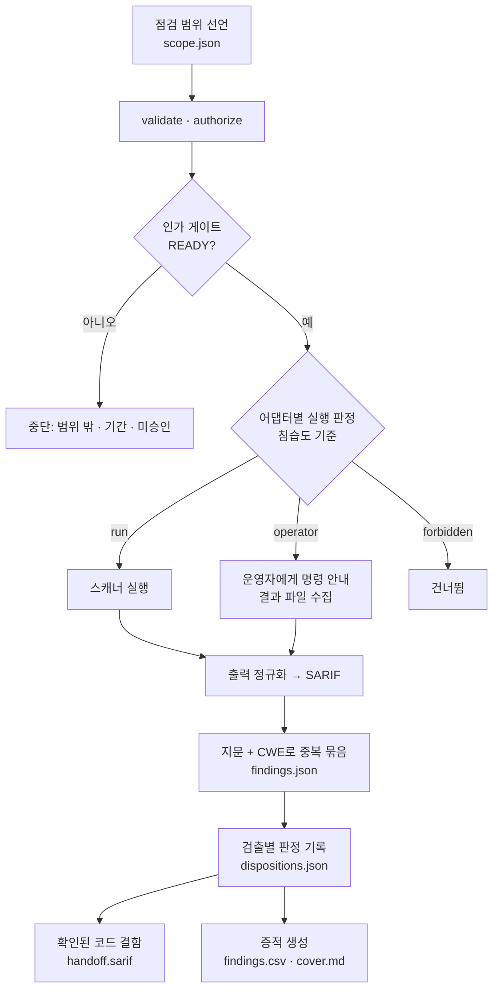

# security-assessment 툴킷

인가 기반 보안 취약점 점검 오케스트레이터. 인가 범위를 선언하고, 그 안에서
기성 오픈소스 스캐너를 조율해 검출을 모으고, 판정·증적을 만들며, 확인된 코드
결함은 sast-remediation으로 넘긴다. 웹·인프라 스캐너와 방법론 체크리스트는
아직 없다.

이 스킬은 **인가된 점검**만 수행한다. 게이트는 선언한 범위를 벗어나는 실수를
막고 인가 주장을 기록하지만, 동의가 진짜인지는 검증하지 못한다(악의적 사용자는
막지 못한다). 설계 정본은 저장소 루트 `CONTEXT.md`, `docs/adr/`,
`docs/superpowers/*/2026-10-14-security-assessment*`. 구조와 동작 원리는
`docs/HOW_IT_WORKS.md`에 있다.

## 작업 흐름



## 빠른 시작

1. 이 디렉터리를 대상 프로젝트에 `security-assessment-toolkit/`으로 복사한다.
2. `data/scope.json`에 범위를 적는다(`examples/scope.json` 형식). 절차는
   `prompts/00-authorize.md`.
3. 인가 게이트를 통과시킨다.

```bash
python3 tools/assess_toolkit.py validate
python3 tools/assess_toolkit.py authorize
python3 tools/assess_toolkit.py gate        # READY여야 다음으로
```

4. 어댑터(`adapters/*.json`)를 두고 스캔한다. 스킬이 직접 실행하는 것은
   비파괴 어댑터를 사용자가 명시했을 때(`--direct`)뿐이다.

```bash
python3 tools/assess_toolkit.py adapters    # 어댑터별 실행 판정 확인
python3 tools/assess_toolkit.py scan --direct
```

5. 검출마다 판정을 `data/dispositions.json`에 기록하고, 확인된 코드 결함을 넘기고,
   증적을 만든다.

```bash
python3 tools/assess_toolkit.py dispositions   # 판정·확인 단계 집계
python3 tools/assess_toolkit.py bridge         # confirmed 코드 결함 → data/handoff.sarif
python3 tools/assess_toolkit.py evidence       # evidence/findings.csv + evidence/cover.md
python3 tools/assess_toolkit.py validate
```

## 명령

| 명령 | 용도 |
|---|---|
| `validate` | 스코프·어댑터·검출·판정·증적의 형식·정합성 검사. `--strict`는 게이트 미통과도 에러 |
| `authorize` | 현재 스코프의 의미 지문 기록, status를 authorized로 |
| `gate` | 승인·지문·기간 재대조 → READY/BLOCKED |
| `adapters` | 어댑터별 실행 판정 표시(명령 미실행). `--direct`는 사용자가 직접 실행을 명시했다고 봄 |
| `scan` | 게이트 READY일 때 'run' 판정 어댑터를 실행하고 출력을 수집·묶어 `data/findings.json`에 쓴다. `--direct` 필요. operator 판정은 명령만 안내 |
| `dispositions` | 검출별 판정·확인 단계 집계(JSON). 레코드 없는 검출은 unreviewed로 센다 |
| `bridge` | confirmed 코드 결함을 SARIF(`data/handoff.sarif`)로 내보내고 handedOff 표시. `--dry-run`·`--all` |
| `evidence` | 증적 워크북 `evidence/findings.csv`와 표지 보고서 `evidence/cover.md`를 데이터에서 생성. 데이터가 바뀌면 validate가 드리프트를 에러로 |

## 테스트

```bash
python3 -B -m unittest tools.test_assess
```

테스트는 실제 스캐너를 실행하지 않는다(커밋한 출력 샘플과 교체한 실행부로 검증).
원리는 `docs/HOW_IT_WORKS.md`, 버전 정책은 `docs/VERSIONING.md`.
