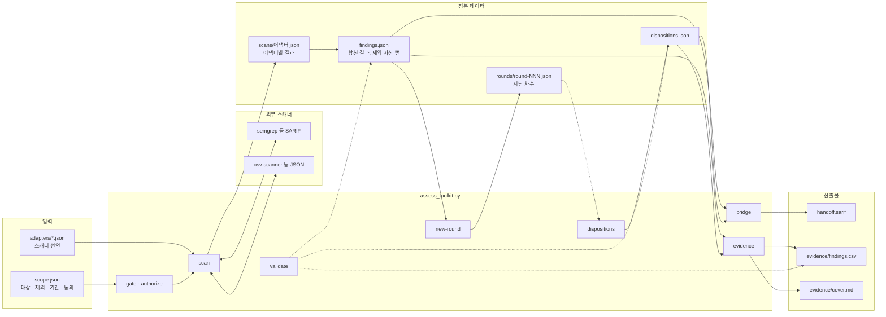
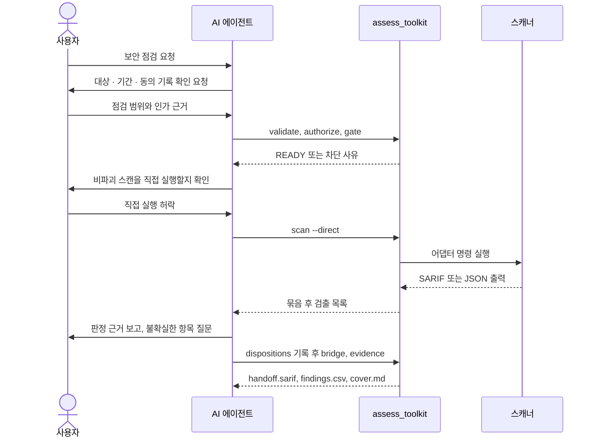

# 동작 원리

이 스킬은 **인가된 보안 점검의 오케스트레이터**다. 이 문서는 무엇이 어떤 파일을
읽고 쓰는지, 사람이 어디서 확인하는지, 그리고 왜 이렇게 만들었는지 설명한다.
따라 하는 순서는 `README.md`의 작업 흐름, 용어 정의는 저장소 루트 `CONTEXT.md`를 본다.

## 구조

입력은 점검 범위와 어댑터 선언이고, 도구는 하나의 명령줄 프로그램이다. 스캔 결과는
어댑터별로 저장된 뒤 합쳐 검출이 되고, 판정은 따로 남는다. 넘김 파일과 증적은 그
정본에서 만들어진다. 점선은 validate의 검사 대상과 지난 차수 비교다.

## 사람이 확인하는 지점

점검 범위와 인가 근거, 스캐너를 직접 실행할지, 불확실한 판정은 사용자가 정한다.
AI는 그 사이의 실행과 기록을 맡는다.

## 인가 게이트가 보장하는 것, 못 하는 것

게이트는 두 가지를 한다: (1) 사용자가 선언한 점검 범위를 벗어나는 **실수를
막고**, (2) 누가·언제·무엇을 인가했다는 **주장을 증적에 기록**한다. 그러나
스킬은 동의가 진짜인지, 인가자가 그 대상을 인가할 권한이 있는지 확인할 방법이
없다. 따라서 게이트는 **악의적 사용자를 막지 못한다**. 실제 보호는 "스킬이
사용자가 선언한 범위를 벗어나지 않는다"까지다. 이 한계를 숨기지 않는다.

## 스코프 변경은 승인을 무효로 한다

승인은 스코프의 **의미 필드**(대상의 type·value, 제외, 기간, 동의, 침습도)에서
만든 지문으로 묶인다. `authorize`가 그 지문을 기록하고, `gate`가 현재 지문과
재대조한다. 의미 필드가 바뀌면 지문이 달라져 승인이 자동 무효가 된다. `notes`
같은 설명 필드는 지문에 들어가지 않으므로 고쳐도 승인이 유지된다. "승인해 놓고
대상 바꿔치기"가 구조적으로 불가능하다(sast-remediation의 입력 게이트와 같은 원리).

## 기간

게이트는 기간(window)을 본다. 시작 전·만료 후에는 승인·지문이 멀쩡해도 BLOCKED다.
종료일을 날짜만 준 경우 그 날의 끝까지 유효로 본다.

## 기계 점검과 의미 확인

`validate`/`gate`는 형식·지문·기간을 **기계로** 검사한다. 대상이 실제 접근
가능한지, 제외 자산과 충돌하는지 같은 **의미 확인**은 사람이 00 프롬프트에서
한다. 게이트 READY는 "형식과 기간이 맞다"는 뜻이지 "점검이 타당하다"는 보증이
아니다.

## 어댑터 실행 판정

어댑터는 데이터로 선언하고(`adapters/*.json`, 스키마 `schemas/adapter.schema.json`),
스킬이 직접 실행할지는 침습도 세 겹으로 판정한다(ADR 0002): ①어댑터 침습도가
스코프 상한을 넘으면 금지, ②`active-nondestructive` 이하 + 사용자 직접 실행 명시면
실행, ③그 외는 운영자에게 명령을 지시. `adapters` 명령이 이 판정을 보여 주되
어떤 명령도 실행하지 않는다. 판정은 순수 함수라 도구 없이 테스트된다. 출력→SARIF
실제 실행과 출력→SARIF 변환은 아래 절에서 다룬다.

## 스캔 수집과 묶음

`scan`은 게이트 READY일 때 'run' 판정 어댑터만 실행한다. 어댑터는 자기 카테고리에
맞는 대상에만 돌린다(sast·sca·secret·iac→repo, dast→web) — SAST를 web 대상에
돌리지 않는다. 실행은 `shell` 없이
argv로 하며 명령 템플릿의 `{target}`·`{output}`를 토큰으로 치환해 주입을 막는다.
도구 출력(SARIF)을 정규화해 검출을 만들고, **지문+CWE가 같으면 하나로 묶어**
출처 스캐너를 `sources`에 보존한다. 지문은 파일+함수(없으면
스니펫)에서 만들어 **줄 번호·ruleId에 비의존**이라 스캐너마다 보고 줄이 달라도
묶인다. 수집·묶음은 순수 함수라 커밋한 SARIF 샘플로 도구 없이 테스트한다. 실제
도구 연동은 저장소 밖 임시 사본에서 확인한다. 판정은 아래 절에서 다룬다.

결과는 **어댑터별로** `data/scans/<어댑터>.json`에 저장되고, `findings.json`은 그
결과들을 합쳐 다시 만든다. 이번에 실행된 어댑터의 결과만 바뀌므로, 어댑터 하나만 다시
돌리거나 `--direct` 없이 실행해도 다른 결과가 사라지지 않는다. 실행된 어댑터가 하나도
없으면 아무것도 쓰지 않는다. 어댑터별 결과 파일이 반쪽으로 저장돼 있으면 스캔을 시작하지
않고 그 파일을 지목한다 — 건너뛰고 합치면 그 어댑터의 결과가 조용히 빠지기 때문이다.

합칠 때 **제외 자산**에 속한 검출을 걸러낸다. 파일 위치는 경로 경계로(`src/dao`는
`src/dao/...`를 제외하지만 `src/daolike`는 아니다), URL 위치는 URL 접두사나 호스트(하위
도메인 포함)로 비교한다. 제외 자산이 결과에 남아 있으면 validate가 에러를 낸다.

## 정규화기

네이티브 SARIF를 내지 않는 도구는 `output_format`이 정규화기를 가리킨다.
`NORMALIZERS`는 형식 이름 → SARIF 변환 함수 테이블이고, `sarif`는 그대로 통과,
`osv-json`은 OSV-scanner 출력을 SARIF로 바꾼다(의존성 취약점: 위치는 매니페스트,
패키지를 논리 위치로 둬 지문이 패키지로 묶이게, CWE·CVSS 보존). 새 도구를 붙이면
정규화기 하나만 추가하고 어댑터가 그 이름을 가리킨다. 변환은 순수 함수라 커밋한
출력 샘플로 도구 없이 테스트한다.

## 판정과 확인 단계

검출(findings)과 판정(dispositions)은 별개 파일이다. 스캔은 검출만 만들고 판정은 따로 기록한다.
판정은 두 축이다: **판정**(unreviewed/confirmed/suspected/false-positive/
out-of-scope/needs-review)과 **확인 단계**(unreviewed/in-review/reviewed).
confirmed·false-positive·out-of-scope는 근거가 없으면 validate 에러다. confirmed
코드 결함만 sast-remediation으로 넘길 수 있고(handedOff), 조치 진행은 그쪽이
추적한다(ADR 0001). 판정 레코드는 'fingerprint:cwe'로 검출 하나를 가리키며,
없는 검출을 가리키면 에러다. `dispositions` 명령이 판정·단계별 건수를 보여 준다.

## SARIF 다리

`bridge`는 **confirmed 코드 결함**만 SARIF로 내보낸다(`data/handoff.sarif`). 웹
(DAST) 검출처럼 위치가 URL인 것은 코드 결함이 아니라 제외한다. 내보낸 판정에는
handedOff 표시가 붙고, 조치 진행은 sast-remediation이 추적한다(ADR 0001) —
해소는 다음 차수 재점검으로만 판단한다(아래 「점검 차수와 해소」). 기본은 아직 안 넘긴 것만, `--all`은 전부
다시, `--dry-run`은 건수만. 생성된 SARIF를 sast-remediation 프로젝트의 input/에
넣어 조치를 잇는다.

## 점검 차수와 해소

다시 점검할 때는 `new-round`로 현재 차수를 닫는다. 현재 검출과 이번 차수에 실행된
어댑터 목록이 `data/rounds/round-NNN.json`에 보관되고, 어댑터별 결과와 `findings.json`이
비워진다. 판정은 `fingerprint:cwe` 키로 이어지므로 그대로 둔다. 보관된 차수에만 있는
검출을 가리키는 판정은 유효한 기록이라 validate가 에러로 보지 않는다.

새 차수에서 스캔한 뒤 `dispositions`를 보면 `sincePreviousRound`에 직전 차수 대비
결과가 나온다. 사라진 검출은 **그 검출을 찾았던 어댑터가 이번 차수에 모두 다시 돌았을
때만** `resolved`(해소)다. 다시 돌지 않았으면 `notRechecked`(재확인 안 됨)로 남는다.
스캐너를 돌리지 않아 안 보이는 것을 고쳐진 것으로 세지 않기 위해서다.

## 증적

`evidence`는 같은 데이터(scope·findings·dispositions)에서 **증적 워크북**
(`evidence/findings.csv`, 검출 하나가 한 행)과 **표지 보고서**(`evidence/cover.md`,
범위·인가·방법·집계)를 만든다. 둘 다 생성물이라 숫자가 구조적으로 일치하고,
데이터가 바뀐 뒤 다시 생성하지 않으면 validate가 드리프트를 에러로 잡는다(sast의
생성 문서와 같은 방식). 툴킷은 표준 라이브러리만 쓰므로 xlsx 대신 CSV·Markdown을
낸다 — CSV는 스프레드시트에서 열리고 표지 보고서는 문서로 변환할 수 있다. 생성물에
현재 시각을 넣지 않아 같은 데이터면 같은 결과가 나온다. 손으로 고친 표지 보고서는
숫자를 검사할 수 없어 경고한다.

## 앞으로

웹(DAST)·인프라 스캐너와 방법론 체크리스트를 추가할 예정이다. 그때도 게이트 READY가 전제이며, 침습적 단계는
스코프에 건별 인가가 있고 운영자가 실행할 때만 허용한다. 계획은
`docs/superpowers/plans/2026-10-14-security-assessment.md`.
