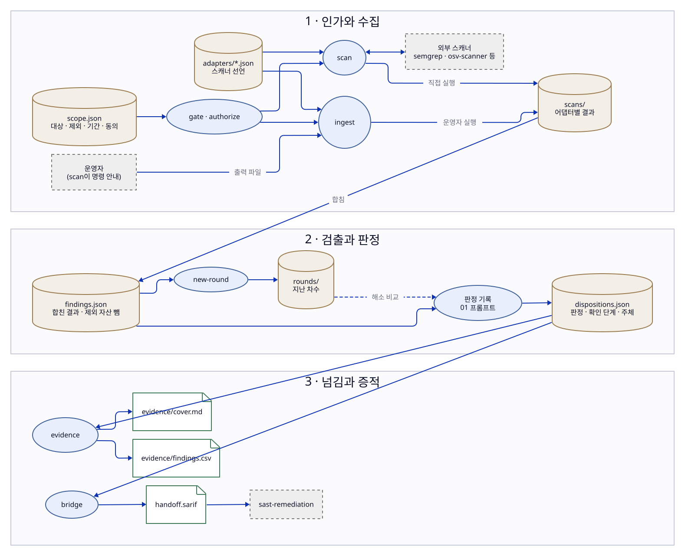

# 동작 원리

이 스킬은 **인가된 보안 점검의 오케스트레이터**다. 이 문서는 무엇이 어떤 파일을
읽고 쓰는지, 사람이 어디서 확인하는지, 그리고 왜 이렇게 만들었는지 설명한다.
따라 하는 순서는 `README.md`의 작업 흐름, 용어 정의는 저장소 루트 `CONTEXT.md`를 본다.

## 구조

입력은 점검 범위와 어댑터 선언이고, 도구는 하나의 명령줄 프로그램이다. 스캔 결과는
어댑터별로 저장된 뒤 합쳐 검출이 되고, 판정은 따로 남는다. 넘김 파일과 증적은 그
정본에서 만들어진다. validate는 이 정본과 산출물이 서로 맞는지 검사한다.
원통은 저장 파일, 타원은 명령, 문서 모양은 문서·산출물, 점선 상자는 스킬 밖의 대상이다.

이미지를 누르면 원래 크기로 열린다.

## 사람이 확인하는 지점

점검 범위와 인가 근거, 스캐너를 직접 실행할지, 웹 스캔의 실행 계획, 오탐·범위 밖 확정과
불확실한 판정은 사용자가 정한다. AI는 그 사이의 실행과 기록을 맡는다.

## 인가 게이트가 보장하는 것, 못 하는 것

게이트는 두 가지를 한다: (1) 사용자가 선언한 점검 범위를 벗어나는 **실수를
막고**, (2) 누가·언제·무엇을 인가했다는 **주장을 증적에 기록**한다. 그러나
스킬은 동의가 진짜인지, 인가자가 그 대상을 인가할 권한이 있는지 확인할 방법이
없다. 따라서 게이트는 **악의적 사용자를 막지 못한다**. 실제 보호는 "스킬이
사용자가 선언한 범위를 벗어나지 않는다"까지다. 이 한계를 숨기지 않는다.

## 스코프 변경은 승인을 무효로 한다

승인은 스코프의 **의미 필드**(대상의 type·value, 제외, 기간, 동의, 침습도)에서
만든 지문으로 묶인다. `authorize`가 그 지문을 기록하고, `gate`가 현재 지문과
재대조한다. 의미 필드가 바뀌면 지문이 달라져 승인이 자동 무효가 된다. `notes`
같은 설명 필드는 지문에 들어가지 않으므로 고쳐도 승인이 유지된다. "승인해 놓고
대상 바꿔치기"가 구조적으로 불가능하다(sast-remediation의 입력 게이트와 같은 원리).

## 기간

게이트는 기간(window)을 본다. 시작 전·만료 후에는 승인·지문이 멀쩡해도 BLOCKED다.
종료일을 날짜만 준 경우 그 날의 끝까지 유효로 본다.

## 기계 점검과 의미 확인

`validate`/`gate`는 형식·지문·기간을 **기계로** 검사한다. 대상이 실제 접근
가능한지, 제외 자산과 충돌하는지 같은 **의미 확인**은 사람이 00 프롬프트에서
한다. 게이트 READY는 "형식과 기간이 맞다"는 뜻이지 "점검이 타당하다"는 보증이
아니다.

## 어댑터 실행 판정

어댑터는 데이터로 선언하고(`adapters/*.json`, 스키마 `schemas/adapter.schema.json`),
스킬이 직접 실행할지는 침습도 세 겹으로 판정한다(ADR 0002): ①어댑터 침습도가
스코프 상한을 넘으면 금지, ②`active-nondestructive` 이하 + 사용자 직접 실행 명시면
실행, ③그 외는 운영자에게 명령을 지시. `adapters` 명령이 이 판정을 보여 주되
어떤 명령도 실행하지 않는다. 판정은 순수 함수라 도구 없이 테스트된다. 출력→SARIF
실제 실행과 출력→SARIF 변환은 아래 절에서 다룬다.

## 스캔 수집과 묶음

`scan`은 게이트 READY일 때 'run' 판정 어댑터만 실행한다. 어댑터는 자기 카테고리에
맞는 대상에만 돌린다(sast·sca·secret·iac→repo, dast→web) — SAST를 web 대상에
돌리지 않는다. 실행은 `shell` 없이
argv로 하며 명령 템플릿의 `{target}`·`{output}`(컨테이너 마운트용 `{output_dir}`·
`{output_name}`)를 토큰으로 나눈 뒤 치환해 주입을 막는다.
도구 출력(SARIF)을 정규화해 검출을 만들고, **지문+CWE가 같으면 하나로 묶어**
출처 스캐너를 `sources`에 보존한다. 지문은 파일+함수(없으면
스니펫)에서 만들어 **줄 번호·ruleId에 비의존**이라 스캐너마다 보고 줄이 달라도
묶인다. 수집·묶음은 순수 함수라 커밋한 SARIF 샘플로 도구 없이 테스트한다. 실제
도구 연동은 저장소 밖 임시 사본에서 확인한다. 판정은 아래 절에서 다룬다.

결과는 **어댑터별로** `data/scans/<어댑터>.json`에 저장되고, `findings.json`은 그
결과들을 합쳐 다시 만든다. 이번에 실행된 어댑터의 결과만 바뀌므로, 어댑터 하나만 다시
돌리거나 `--direct` 없이 실행해도 다른 결과가 사라지지 않는다. 실행된 어댑터가 하나도
없으면 아무것도 쓰지 않는다. 어댑터별 결과 파일이 반쪽으로 저장돼 있으면 스캔을 시작하지
않고 그 파일을 지목한다 — 건너뛰고 합치면 그 어댑터의 결과가 조용히 빠지기 때문이다.

'operator' 판정 어댑터는 스킬이 돌리지 않는다. `scan`이 대상별 명령과 들여오기 명령을
안내하고, 운영자가 실행해 넘긴 출력 파일을 `ingest`가 들여온다. 들여오기도 게이트
READY가 전제이고, 스코프 상한을 넘는(forbidden) 어댑터의 출력은 받지 않는다. 대상은
그 어댑터 카테고리에 맞는 스코프 대상이어야 한다. 정규화·묶음·제외 자산 처리는 `scan`과
같고, 같은 어댑터·같은 대상의 이전 결과만 바뀐다. 어댑터별 결과에 출력 파일 이름과
SHA-256을 남기고, 검출 출처에 `collectedBy: operator`를 붙인다(스킬이 돌린 것은 `skill`).
운영자가 다시 돌려 들여오면 그 어댑터가 이번 차수에 돈 것으로 보고 해소 판단에 쓴다.

합칠 때 **제외 자산**에 속한 검출을 걸러낸다. 파일 위치는 경로 경계로(`src/dao`는
`src/dao/...`를 제외하지만 `src/daolike`는 아니다), URL 위치는 URL 접두사나 호스트(하위
도메인 포함)로 비교한다. 제외 자산이 결과에 남아 있으면 validate가 에러를 낸다.

## 웹 스캔

웹(DAST) 스캐너는 실행 중인 대상에 실제 요청을 보내므로, 결과에서 제외 자산을 빼는 것만으로는
범위를 지킬 수 없다. 그래서 웹 어댑터에는 세 가지 선언이 붙는다.

- **범위 제어**(`scope_control`): 스캐너가 대상 밖 호스트로 나가지 않는다는 선언
  (`stays_on_target`)과, 대상 안의 제외 자산을 스캐너 옵션으로 넘기는 방법(`exclude_host`,
  `exclude_url`). 대상 안에 넘길 수 없는 제외 자산이 있으면 그 대상은 실행도 들여오기도
  거부한다. 스캐너가 제외 자산을 지켰는지 알 수 없기 때문이다.
- **요청 상한**(`rate_limit`): 스코프의 웹 대상에 적힌 초당 요청 상한(`rateLimit`, 없으면
  보수적 기본값)을 스캐너 옵션으로 넘기는 방법. 상한은 소유자가 동의한 조건이라 스코프의
  의미 필드이고, 바꾸면 다시 authorize해야 한다.
- **커버리지**(`coverage`): 한 실행이 실제로 본 범위. `fixed-probes`는 매번 같은 탐침을 대상
  전체에 보내는 도구, `url-list`는 방문 URL 파일을 남기는 도구, `none`은 알 수 없음이다.

범위 제어나 요청 상한을 넘길 방법이 없는 웹 어댑터는 침습도와 무관하게 스킬이 직접 돌리지
않고 운영자 명령만 안내한다. 직접 돌릴 수 있어도 `scan --direct`는 먼저 실행 계획(대상 URL,
요청 상한, 최대 실행 시간, 제외 호스트·URL)과 확인 코드만 보여 준다. 사용자가 그 계획을
확인하면 `--confirm <코드>`로 다시 실행해야 돈다. 계획이 한 글자라도 바뀌면 코드가 바뀌므로
확인은 그 실행 하나에만 유효하다. 실행 시간은 어댑터 상한(`max_seconds`)과 점검 기간 끝까지
남은 시간 중 짧은 쪽으로 끊는다. 로그인이 필요한 표면은 스킬이 스캔하지 않는다 — 운영자가
돌리고 `ingest`로 들여온다(`--coverage`로 방문 URL 파일을 함께 넘길 수 있다).

웹 검출의 지문은 메서드·정규화한 경로·파라미터 이름으로 만든다. 경로의 숫자·식별자
세그먼트는 자리표시자가 되고, 쿼리 값·세션 토큰·증거 문자열은 넣지 않는다. 그래서 같은
결함을 다른 주문 번호나 토큰으로 다시 찾아도 같은 검출로 묶이고, 같은 경로의 다른 파라미터
결함은 따로 남는다. 웹 검출은 코드 결함이 아니라 sast-remediation으로 넘기지 않는다.
절차는 `prompts/02-web-scan.md`, 결정 경위는 ADR 0003.

## 정규화기

네이티브 SARIF를 내지 않는 도구는 `output_format`이 정규화기를 가리킨다.
`NORMALIZERS`는 형식 이름 → SARIF 변환 함수 테이블이고, `sarif`는 그대로 통과,
`osv-json`은 OSV-scanner 출력을 SARIF로 바꾼다(의존성 취약점: 위치는 매니페스트,
패키지를 논리 위치로 둬 지문이 패키지로 묶이게, CWE·CVSS 보존). `zap-json`은 ZAP JSON
보고서를 바꾼다(경고 인스턴스 하나가 결과 하나, 메서드·파라미터를 보존해 URL 지문에 쓴다). 새 도구를 붙이면
정규화기 하나만 추가하고 어댑터가 그 이름을 가리킨다. 변환은 순수 함수라 커밋한
출력 샘플로 도구 없이 테스트한다.

## 판정과 확인 단계

검출(findings)과 판정(dispositions)은 별개 파일이다. 스캔은 검출만 만들고 판정은 따로 기록한다.
판정은 두 축이다: **판정**(unreviewed/confirmed/suspected/false-positive/
out-of-scope/needs-review)과 **확인 단계**(unreviewed/in-review/reviewed).
confirmed·false-positive·out-of-scope는 근거가 없으면 validate 에러다. confirmed
코드 결함만 sast-remediation으로 넘길 수 있고(handedOff), 조치 진행은 그쪽이
추적한다(ADR 0001). 판정 레코드는 'fingerprint:cwe'로 검출 하나를 가리키며,
없는 검출을 가리키면 에러다. `dispositions` 명령이 판정·단계별 건수를 보여 준다.

판정마다 **판정 주체**(`decidedBy`)를 남긴다: `user`는 사용자가 확인한 것, `ai`는 AI가
근거로 판정한 것이다. false-positive·out-of-scope는 위험을 닫는 판정이라 reviewed로
확정하는 것은 사용자만 한다. AI는 in-review로 제안하고, 사용자가 확인하면 `user`로
확정한다. ai가 이 두 판정을 reviewed로 확정한 레코드는 validate 에러다. 결함을 인정하는
confirmed와 판단을 미루는 suspected·needs-review는 AI도 근거와 함께 확정할 수 있다 —
잘못돼도 위험이 열린 채로 남을 뿐 숨겨지지 않기 때문이다. reviewed인데 주체가 없으면
경고한다. 증적 워크북에 주체 열이 있고, 표지 보고서에 확정한 주체별 건수가 나온다. 판정
절차는 `prompts/01-triage.md`.

## SARIF 다리

`bridge`는 **confirmed 코드 결함**만 SARIF로 내보낸다(`data/handoff.sarif`). 웹
(DAST) 검출처럼 위치가 URL인 것은 코드 결함이 아니라 제외한다. 내보낸 판정에는
handedOff 표시가 붙고, 조치 진행은 sast-remediation이 추적한다(ADR 0001) —
해소는 다음 차수 재점검으로만 판단한다(아래 「점검 차수와 해소」). 기본은 아직 안 넘긴 것만, `--all`은 전부
다시, `--dry-run`은 건수만. 생성된 SARIF를 sast-remediation 프로젝트의 input/에
넣어 조치를 잇는다.

## 점검 차수와 해소

다시 점검할 때는 `new-round`로 현재 차수를 닫는다. 현재 검출과 이번 차수에 실행된
어댑터 목록이 `data/rounds/round-NNN.json`에 보관되고, 어댑터별 결과와 `findings.json`이
비워진다. 판정은 `fingerprint:cwe` 키로 이어지므로 그대로 둔다. 보관된 차수에만 있는
검출을 가리키는 판정은 유효한 기록이라 validate가 에러로 보지 않는다.

새 차수에서 스캔한 뒤 `dispositions`를 보면 `sincePreviousRound`에 직전 차수 대비
결과가 나온다. 사라진 검출은 **그 검출을 찾았던 어댑터가 이번 차수에 모두 다시 돌았을
때만** `resolved`(해소)다. 다시 돌지 않았으면 `notRechecked`(재확인 안 됨)로 남는다.
스캐너를 돌리지 않아 안 보이는 것을 고쳐진 것으로 세지 않기 위해서다. 웹 검출은 크롤링
범위가 실행마다 달라 조건이 하나 더 붙는다: 그 실행의 커버리지가 검출의 경로를 덮어야
해소다. 커버리지가 없거나 그 경로를 방문하지 않았으면 재확인 안 됨이다.

## 증적

`evidence`는 같은 데이터(scope·findings·dispositions)에서 **증적 워크북**
(`evidence/findings.csv`, 검출 하나가 한 행)과 **표지 보고서**(`evidence/cover.md`,
범위·인가·방법·집계)를 만든다. 둘 다 생성물이라 숫자가 구조적으로 일치하고,
데이터가 바뀐 뒤 다시 생성하지 않으면 validate가 드리프트를 에러로 잡는다(sast의
생성 문서와 같은 방식). 툴킷은 표준 라이브러리만 쓰므로 xlsx 대신 CSV·Markdown을
낸다 — CSV는 스프레드시트에서 열리고 표지 보고서는 문서로 변환할 수 있다. 생성물에
현재 시각을 넣지 않아 같은 데이터면 같은 결과가 나온다. 손으로 고친 표지 보고서는
숫자를 검사할 수 없어 경고한다.

## 앞으로

인프라 스캐너와 방법론 체크리스트를 추가할 예정이다. 그때도 게이트 READY가 전제이며, 침습적 단계는
스코프에 건별 인가가 있고 운영자가 실행할 때만 허용한다. 계획은
`docs/superpowers/plans/2026-10-14-security-assessment.md`.
