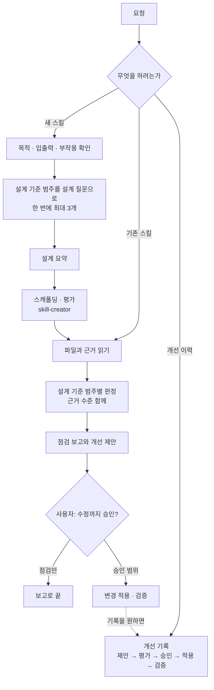

# skill-architect

이 저장소의 **스킬 설계 기준**을 제공하고 적용하는 메타 스킬입니다. 같은 기준으로
새 스킬을 설계하고, 기존 스킬을 점검하고, 원하면 개선 이력을 남깁니다. 문서·코드·실행
근거로 판단하고, 확인한 사항과 확인하지 못한 사항을 구분합니다.

## 작업 흐름

세 갈래 모두 같은 설계 기준(`ARCHITECTURE_CHECKLIST.md`)을 씁니다. 새 스킬은 설계를
마친 뒤 점검 절차로 한 번 확인합니다. 점검만 요청하면 보고로 끝나고, 수정은 사용자가
승인한 범위에서만 합니다.

## 이렇게 요청합니다

- "새 스킬을 설계하려는데 기준에 맞춰 같이 봐줘"
- "이 스킬 점검해줘" / "sast-remediation 스킬 감사해줘"
- "지난 점검에서 승인한 개선을 적용하고 기록해줘" (개선 기록 사용)

## 문서

| 문서 | 내용 |
|---|---|
| [ARCHITECTURE_CHECKLIST.md](ARCHITECTURE_CHECKLIST.md) | 스킬 설계 기준 — 10개 범주와 점검할 때의 판정 |
| [SKILL.md](SKILL.md) | 설계·점검 절차, 소스 탐색 규칙, 보고 형식 |
| [docs/HOW_IT_WORKS.md](docs/HOW_IT_WORKS.md) | 구성 파일과 개선 기록의 경계 |
| [references/improvement-workflow.md](references/improvement-workflow.md) | 선택적 개선 기록 절차와 CLI |
