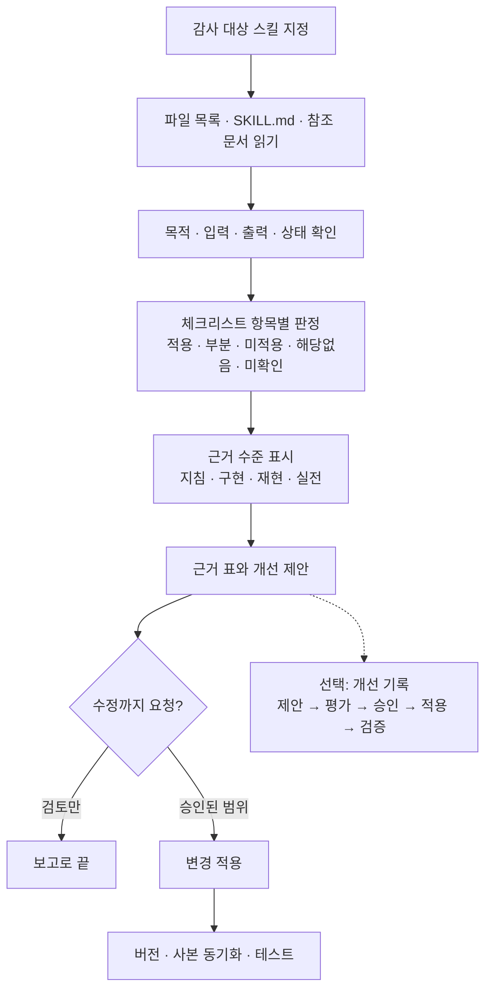

# skill-architect

에이전트 스킬(`SKILL.md`)의 설계와 품질을 문서·코드·실행 근거로 감사하고, 새 스킬의
설계를 돕는 메타 스킬입니다. 확인한 사항과 확인하지 못한 사항을 구분해 보고합니다.

## 작업 흐름

감사만 요청하면 근거 표와 개선 제안으로 끝납니다. 수정은 사용자가 승인한 범위에서만
하고, 개선 이력을 남기는 기록은 원할 때만 씁니다.

## 이렇게 요청합니다

- "이 스킬 감사해줘" / "sast-remediation 스킬 감사해줘"
- "새 스킬을 설계하려는데 같이 봐줘"
- "지난 감사에서 승인한 개선을 적용하고 기록해줘" (개선 기록 사용)

## 문서

| 문서 | 내용 |
|---|---|
| [SKILL.md](SKILL.md) | 감사·설계 절차, 소스 탐색 규칙, 보고 형식 |
| [ARCHITECTURE_CHECKLIST.md](ARCHITECTURE_CHECKLIST.md) | 판정 기준과 10개 범주 |
| [docs/HOW_IT_WORKS.md](docs/HOW_IT_WORKS.md) | 구성 파일과 개선 기록의 경계 |
| [references/improvement-workflow.md](references/improvement-workflow.md) | 선택적 개선 기록 절차와 CLI |
