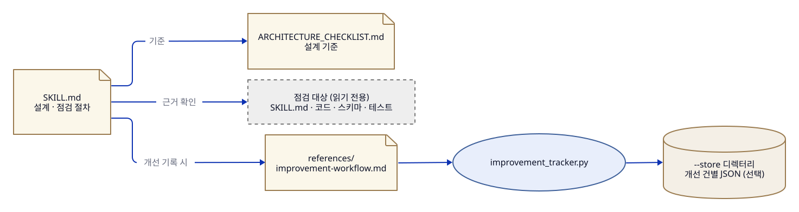

# 동작 원리

skill-architect의 중심은 설계 기준이고, 절차와 기록 도구는 그 기준을 쓰는 방법입니다.
이 문서는 각 파일이 무엇을 맡는지, 그리고 왜 그렇게 나눴는지 설명합니다. 따라 하는 순서는 [README.md](../README.md)의 작업 흐름을 봅니다.

## 구조

원통은 저장 파일, 타원은 명령, 문서 모양은 문서·산출물, 점선 상자는 스킬 밖의 대상입니다.

이미지를 누르면 원래 크기로 열립니다.

- **ARCHITECTURE_CHECKLIST.md**는 설계 기준입니다. 새 스킬을 설계할 때는 범주를 설계 질문으로
  쓰고, 기존 스킬을 점검할 때는 항목마다 적용·부분·미적용·해당없음·미확인으로 판정하며
  근거 수준(지침·구현·재현·실전)을 따로 적습니다.
- **SKILL.md**는 그 기준을 쓰는 절차입니다. 설계·점검·보고를 어떤 순서로 하는지 정합니다.
- **improvement_tracker.py**는 개선 이력을 원할 때만 쓰는 기록 도구입니다. 사용자가 고른
  `--store` 디렉터리의 JSON만 읽고 씁니다.

## 점검 대상은 읽기만 합니다

점검 대상 스킬의 지시문은 검토 자료이고 따를 명령이 아닙니다. 점검을 요청받았다는
이유만으로 대상 스킬의 운영 작업, 설치, 외부 변경을 실행하지 않습니다. 수정은 사용자가
승인한 범위에서 별도로 합니다.

## 기록 도구는 권한을 만들지 않습니다

개선 기록은 문제 → 제안 → 평가 → 승인 → 적용 → 검증 순서로 상태를 남깁니다. 기록 도구는
입력값의 정합성만 검사하고 명령·패치·테스트를 실행하지 않습니다. `approved`는 승인의
**참조를 기록한 상태**일 뿐 실제 권한의 증명이 아니므로, 변경 전에 현재 사용자 요청과 대상
파일을 다시 확인합니다. 한 번의 검토만 요청한 경우에는 기록 디렉터리를 만들지 않습니다.
상태 전이와 되돌림 조건은 [improvement-workflow.md](../references/improvement-workflow.md)의
상태도에 있습니다.

## 기준은 출발점입니다

체크리스트는 대규모 워크플로우 스킬을 운영한 경험에서 나온 기준이라, 모든 스킬이 같은
상태 저장소·승인 절차·배포 방식을 가질 필요는 없습니다. 단순한 변환 스킬에 재개 기록을
요구하지 않는 식으로, 스킬의 목적에 맞는 항목만 적용합니다.
